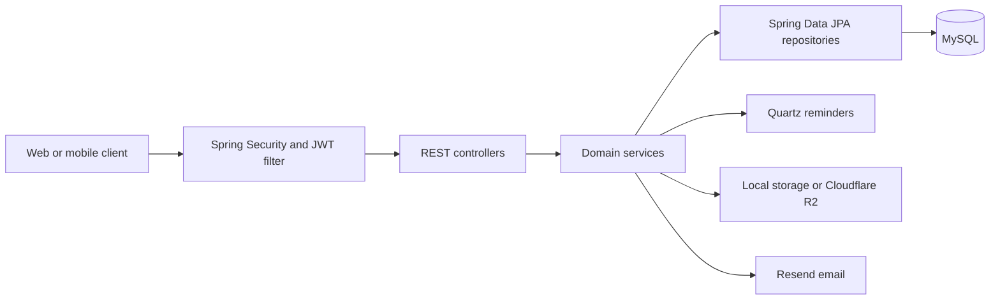

# CampusLife API

CampusLife helps universities manage student activities from publication and registration through attendance, submissions, scoring, and reporting. This repository contains the Spring Boot REST API used by administrators, activity managers, and students; the web client lives in the [frontend repository](https://github.com/mchien04/CampusLifeReact).

## Key features

- **Activities and participation:** Publish activities and series, manage approvals and waitlists, issue ticket codes, record QR or staff-assisted check-in, and export participation reports.
- **Scoring:** Apply configurable rules to attendance, graded submissions, mini games, and series milestones. Record score entries, recalculate student totals, handle manual adjustments, and resolve score appeals.
- **Event operations:** Assign preparation tasks, collect completion evidence, manage budgets, advances, and expenses, and export finance reports.
- **Content and communication:** Manage event articles and comments; send in-app notifications, scheduled reminders, and email when the relevant services are configured.

## Tech stack

| Area | Technology |
| --- | --- |
| Runtime and framework | Java 21, Spring Boot 3.5.5, Maven Wrapper |
| API and security | Spring Web, Spring Security, Bean Validation, JWT (JJWT) |
| Persistence | Spring Data JPA / Hibernate, MySQL; H2 for tests |
| Jobs and exports | Quartz, Apache POI, OpenPDF |
| Integrations | Resend API, Firebase Admin SDK, AWS S3 SDK for Cloudflare R2 |
| Testing | Spring Boot Test, Spring Security Test, JUnit |

## Architecture

The application is a layered Spring Boot service. JWT authentication and role-based rules protect REST controllers; domain services implement workflows and transactions; Spring Data repositories persist entities in MySQL. Upload storage is selected by configuration: local files by default or Cloudflare R2. Quartz schedules reminders with a JDBC job store.



The main domains are authentication and academic administration, activities and registrations, tasks and preparation finance, series and mini games, scoring, articles, and notifications. Firebase push and an external recommendation API also have integration code; they require separate services or credentials and are not needed for the core web flow.

## Project structure

```text
src/main/java/vn/campuslife/
├── controller/       REST endpoints by domain
├── service/          Service contracts and business logic
├── repository/       JPA repositories and queries
├── entity/           Persistence models
├── model/            Request and response models
├── security/         Department scope support
├── filter/           JWT and request context filters
├── config/           Security, storage, scheduling, and web configuration
└── job/              Quartz job entry points
src/main/resources/  Application configuration and reference data
src/test/            Automated tests
db/migration/        SQL scripts for schema changes
docs/                Additional API and workflow notes
```

## Getting started

**Prerequisites:** JDK 21 and a running MySQL server. The Maven Wrapper is included. The separate frontend uses Node.js 20.

1. Create a local database:

   ```sql
   CREATE DATABASE campuslife_db;
   ```

2. Set the environment variables for your MySQL connection and a private JWT secret. For a local run without Firebase credentials, also set `FIREBASE_ENABLED=false`. For example, in a Unix-like shell:

   ```bash
   export DATABASE_URL='jdbc:mysql://localhost:3306/campuslife_db'
   export DATABASE_USERNAME='your_mysql_user'
   export DATABASE_PASSWORD='your_mysql_password'
   export JWT_SECRET='replace-with-a-long-random-secret'
   export FIREBASE_ENABLED=false
   ```

   Set the same variables in your IDE or PowerShell environment on Windows. Spring Boot does not load a `.env` file automatically.

3. Start the API from the repository root:

   ```bash
   ./mvnw spring-boot:run
   ```

   On Windows, use `.\mvnw.cmd spring-boot:run`. The default API port is `8080`.

4. Run tests or create a JAR:

   ```bash
   ./mvnw test
   ./mvnw -DskipTests package
   ```

The current configuration uses Hibernate `ddl-auto=update`. SQL files under `db/migration/` are **not automatically applied** by Flyway or Liquibase; review them when updating an existing database.

## Environment variables

| Variable | Purpose |
| --- | --- |
| `DATABASE_URL`, `DATABASE_USERNAME`, `DATABASE_PASSWORD` | MySQL JDBC connection and credentials. |
| `JWT_SECRET` | Secret used to sign JWTs; set a private value outside the repository. |
| `PORT` | HTTP port; defaults to `8080`. |
| `APP_BASE_URL`, `FRONTEND_URL` | Public API URL for generated links and web URL for email links. |
| `UPLOAD_PROVIDER` | `local` by default; set to `r2` for Cloudflare R2. |
| `UPLOAD_DIR` | Local upload directory when using the local provider. |
| `R2_ENDPOINT`, `R2_ACCESS_KEY`, `R2_SECRET_KEY`, `R2_BUCKET`, `R2_CDN_DOMAIN` | R2 connection and public file URL settings when `UPLOAD_PROVIDER=r2`. |
| `RESEND_API_KEY`, `RESEND_FROM_EMAIL` | Required for sending email through Resend. |
| `FIREBASE_ENABLED`, `FIREBASE_SERVICE_ACCOUNT_BASE64` | Disable Firebase for local web development or provide credentials when push notifications are enabled. |
| `APP_RECOMMENDATION_URL` | Endpoint of the separate recommendation service, when used. |
| `SPRING_QUARTZ_JDBC_INITIALIZE_SCHEMA` | Controls Quartz JDBC schema initialization. |

Keep credentials in your local environment or hosting platform settings. Do not commit them to this repository.

## API documentation

Endpoints are grouped under `/api`, including `/api/auth`, `/api/activities`, `/api/registrations`, `/api/series`, `/api/minigames`, `/api/submissions`, `/api/scores`, `/api/preparation`, `/api/articles`, and `/api/notifications`. Protected endpoints expect `Authorization: Bearer <token>`. JSON is used for most requests and responses; uploads use multipart requests, and report endpoints return downloadable files.

See [docs/](docs/) for workflow notes and sequence diagrams. Swagger/OpenAPI is not configured in this repository.

## Deployment

The backend and MySQL database are hosted on Railway. The repository includes a multi-stage [Dockerfile](Dockerfile); deployment environment variables are configured on the hosting platform. File uploads use Cloudflare R2 and email uses Resend in the deployed setup.

GitHub Actions [CI](.github/workflows/ci.yml) runs tests and packages the JAR on pushes and pull requests to `main` and `develop`. The workflow named [cd](.github/workflows/cd.yml) currently runs tests only; it does not deploy to Railway.

## Related repository

- [CampusLife React frontend](https://github.com/mchien04/CampusLifeReact)

## Author

- GitHub profile: **add URL**
- LinkedIn profile: **add URL**
