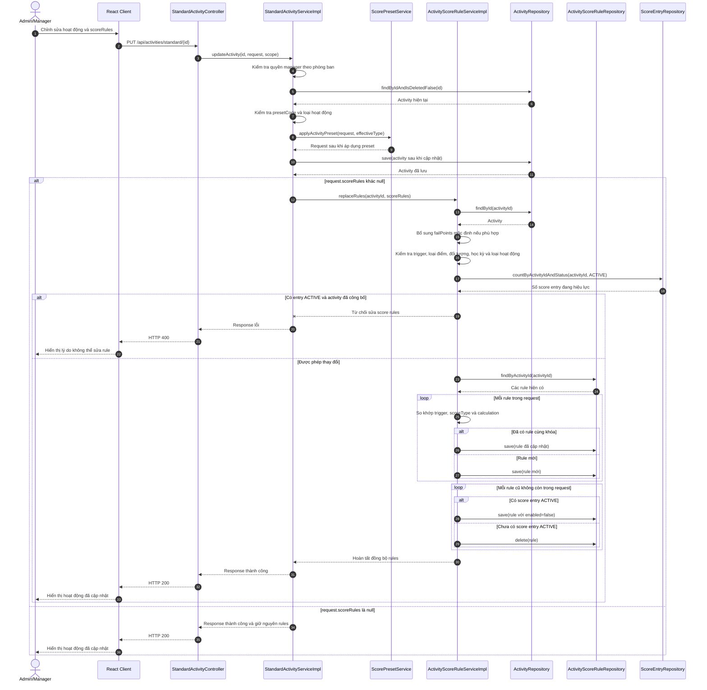
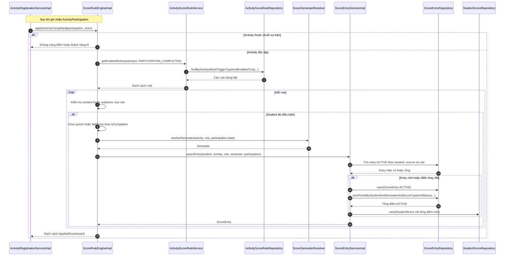

# Sequence Diagram - Score Rule (Quy tắc tính điểm)

Quy tắc tính điểm được gửi cùng dữ liệu tạo hoặc cập nhật hoạt động. Backend lưu chúng qua `ActivityScoreRuleService.replaceRules`; không có endpoint CRUD riêng cho từng score rule. Ví dụ dưới đây dùng luồng cập nhật hoạt động thường qua `PUT /api/activities/standard/{id}`. Hoạt động minigame cũng có `scoreRules` trong request tạo/cập nhật.

## 1. Cấu hình score rule khi cập nhật hoạt động

Khi tạo hoạt động thường, service áp dụng preset, kiểm tra request, lưu `Activity`, rồi chỉ gọi `replaceRules` nếu danh sách `scoreRules` có phần tử. Khi cập nhật, `scoreRules = null` giữ nguyên các rule, còn danh sách rỗng yêu cầu đồng bộ về rỗng.

## 2. Áp dụng score rule sau khi ghi nhận hoàn thành hoạt động

Cùng engine này còn xử lý các trigger khác như `NO_SHOW`, `SUBMISSION_GRADED`, `TASK_OVERDUE`, `MINIGAME_PASSED` và `MINIGAME_EXHAUSTED_ATTEMPTS`. Luồng milestone của chuỗi sự kiện được tính riêng từ `StudentSeriesProgress` và cấu hình milestone của chuỗi.

### Source tham chiếu

- [StandardActivityController](../../src/main/java/vn/campuslife/controller/activity/StandardActivityController.java)
- [StandardActivityServiceImpl](../../src/main/java/vn/campuslife/service/impl/StandardActivityServiceImpl.java)
- [ActivityScoreRuleServiceImpl](../../src/main/java/vn/campuslife/service/impl/ActivityScoreRuleServiceImpl.java)
- [ScoreRuleEngineImpl](../../src/main/java/vn/campuslife/service/impl/ScoreRuleEngineImpl.java)
- [ScoreEntryServiceImpl](../../src/main/java/vn/campuslife/service/impl/ScoreEntryServiceImpl.java)
